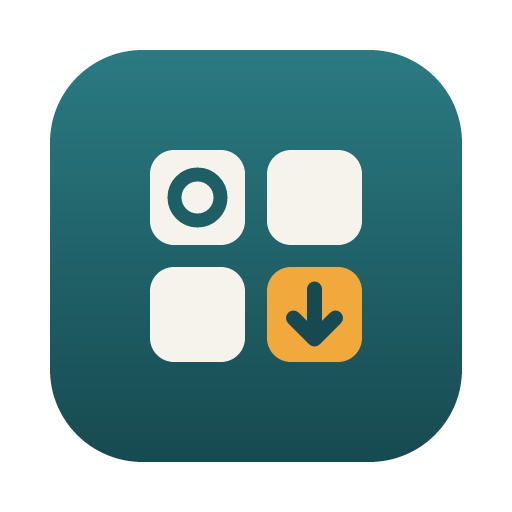

# Otherwise Apps



Install and update Otherwise Technologies' open-source desktop apps in one place:
[genealogy-rs](https://github.com/otherwisetech/genealogy-rs),
[diskmap](https://github.com/otherwisetech/diskmap-rs),
[rama](https://github.com/otherwisetech/rama-rs),
[mosaico](https://github.com/otherwisetech/mosaico-rs) and whatever comes next.

Native desktop app in Rust with [GPUI](https://www.gpui.rs/) and
[gpui-component](https://github.com/longbridge/gpui-component), like the apps it installs. macOS,
Windows and Linux. UI in Spanish, English, Portuguese and French.

## What you see

- **Top bar**: the Otherwise Apps mark, how many apps are installed and how many updates are
  waiting, a search field (⌘F / Ctrl+F) that matches name, tagline and description in your
  language, *Sort by* (name, recently updated, installed first), a grid / list switch, *Check for
  updates* (⌘R), **Update all (n)** when there is anything to update, and Settings (⌘,).
- **Grid** (default): one card per app with its icon, name, a GitHub button, the latest version
  and how long ago it was released, the tagline, a three-line description, the install state
  (*Not installed*, *Installed · 0.3.0*, *Update 0.1.0 → 0.2.0*, *Coming soon*, *Not available for
  Linux yet*) and one main button: **Install** (with the download size), **Update to 0.2.0** or
  **Open**. Cards with an update get an amber outline.
- **List**: the same in compact rows (icon, name, version, tagline, state, button, menu).
- While a job runs the button becomes a progress bar (*Downloading 45 % · 8.4 of 18.7 MB*,
  *Verifying SHA-256…*, *Installing…*) with a cancel button until files start moving. Failures
  show the reason on the card with **Retry**.
- **"…" menu** per app: Open, Release notes (the GitHub release page), Show in Finder / Explorer /
  folder, GitHub, Website, Reinstall, Uninstall….
- When Otherwise Apps itself has an update, a banner offers it above the grid; after updating it
  asks to restart.
- **Footer**: *Checked 2 minutes ago · otherwisetech.com + GitHub* (or *Offline · showing the saved
  catalog*, with the errors in a tooltip) and, on the right, *Otherwise Apps 0.1.0 · Otherwise
  Technologies LLC*, which opens **About** (also in the app menu): logo, version, description,
  credit to Otherwise Technologies LLC, Wyoming, USA with a link to
  [otherwisetech.com](https://otherwisetech.com), the source link and the license.
- **Settings**: language, appearance (system / light / dark), how often to check for updates
  (off, 1, 3, 6, 12 or 24 hours; it also checks at every start), notifications on/off, and the
  install location on Windows and Linux. The Dock icon shows the number of pending updates on
  macOS, and a system notification announces each new release once.

## Hub: Today, Calendar, Entities and MCP

Otherwise Apps is also the hub of the apps, through
[otherwise-link](https://github.com/otherwisetech/otherwise-link):

- **Today** (⌘2): deadlines, alerts and things to review published by every installed app
  (Vigía, Nodo, expense…), merged and grouped by day (overdue, today, tomorrow, later, anytime)
  or by app. Click an item to open it in its app; dismiss it with ×.
- **Entities** (⌘3): the shared registry of people, companies (with tax ids), vehicles,
  properties, devices, sites and domains the apps know. **Off until you turn it on.** Search by
  name, alias, tax id, plate, MAC or host name; see which apps use each entity and open it in
  them; edit name, aliases, tags and notes; merge duplicates (always after a confirmation).
- **Calendar** (⌘5): every app's dates in one month / week / agenda view — Vigía's due dates
  and renewals, expense's planned payments, payroll, subscriptions, tax deadlines and month
  closes (private by default: shown here, "Busy" everywhere else), genealogy-rs birthdays and
  anniversaries (opt-in), Brújula's audits and action-plan due dates, Helio's maintenance — each
  app in its own color, with filters by app and by shared entity. Click an event to open it in
  its app. Public holidays (Colombia, US, Wyoming, Spain, Mexico, Brazil, Canada; computed, the
  same as Vigía and expense) and read-only `.ics` calendars (a file or a URL, kept as a copy so
  they work offline, refreshed only when you ask) overlay it. **Copy ICS link** keeps one
  combined `<Otherwise data folder>/otherwise-apps/calendar/otherwise.ics` up to date (while the
  app runs) for Apple Calendar's *New Calendar Subscription*; Google Calendar needs an http
  address, so use **Export .ics** and import it there. Optionally **Connect Vcity** (Settings →
  Hub or Calendar → Sources): the same browser sign-in as the `vcity` CLI, the session in the
  system keychain only, and your organizations' events and bookings read-only (bookings shown as
  private). Apps publish `<data folder>/<app>/events.json` (otherwise-link SPEC §9); the
  assistant sees the visible range (private events without details) and the hub MCP server
  offers `calendar_events(from, to, apps?)`.
- **Assistant panel** (⌘J, or ⌘4 / the robot button; from every page): the shared
  [otherwise-agent-panel](https://github.com/otherwisetech/otherwise-agent-panel), docked as a
  bar, below, on the right or full window. Ask questions across every installed app ("What's
  due this month at Otherwise SAS?", "Which devices are down?") with **your own** Claude Code,
  Codex or opencode subscription; pick the agent, model and permission mode (read-only, ask
  before changing, automatic). **Chat** streams answers with the app tools used as chips;
  **Terminal** opens the agent itself in an embedded terminal. Attach images, PDFs and files by
  dropping or pasting them. The hub is attached for that session only (a temporary
  `--mcp-config`, `-c` overrides or `OPENCODE_CONFIG_CONTENT`): your Claude / Codex / opencode
  configuration is never touched, and their file, shell and web tools are off. Write tools exist
  only when you allow them in Settings → Hub (and never in read-only mode). The agent knows which
  page you are on. Conversations are kept in `<Otherwise data folder>/otherwise-apps/assistant/`;
  what the assistant reads goes to the provider you chose. Today items have an **Ask** button.
- **Settings → Hub**: shared entities on/off, the command that adds the MCP server to Claude
  Code (`claude mcp add otherwise-hub -- "…/otherwise-apps" mcp`, to copy and run yourself),
  "Allow assistants to make changes" (off by default) and which apps' tools are offered.
- **Links**: Otherwise Apps handles `otherwise://` links. `otherwise://otherwise-apps/today`,
  `…/calendar?date=YYYY-MM-DD`,
  `…/entities/<id>`, `…/assistant` (the panel) and `…/hub` open its pages; a link to another app
  (`otherwise://vigia/item/42`) is passed on to that app, or tells you it isn't installed.

## Where the catalog comes from

1. `https://otherwisetech.com/apps.json`, generated by the website from its app list and the
   latest GitHub releases (schema in [`crates/core/src/catalog.rs`](crates/core/src/catalog.rs)).
2. GitHub's `releases/latest` for every app's repository, which is fresher and carries each
   file's SHA-256 digest. The newer of the two releases wins.
3. If both are unreachable: the catalog saved after the last successful check, else the one
   bundled into the app.

Every URL in a catalog is validated: repositories must belong to `otherwisetech`, and download
links must point at that app's own GitHub releases, so a tampered catalog can't send a download
anywhere else.

## How downloads are verified and installed

1. The right file is picked for your OS and CPU (native build, else universal, else x86_64 under
   Rosetta / Windows-on-ARM emulation).
2. Right before downloading, GitHub's API is asked again for that file's `digest`
   (`sha256:…`, published by GitHub for every release asset). No digest → nothing is downloaded.
3. The file is hashed while it streams to disk. If the SHA-256 doesn't match, the file is deleted
   and nothing is installed.
4. It is unpacked next to the destination (archives with absolute paths, `..` or symlinks
   pointing outside are refused). On macOS the bundle must have the expected
   `CFBundleIdentifier`; the download quarantine flag is removed from that verified bundle only.
5. If the app is running you are asked first; it is asked to quit politely (an Apple Event on
   macOS, so it can save; SIGTERM / WM_CLOSE elsewhere).
6. The old copy is renamed aside, the new one renamed into place (if that fails the old one is
   put back), and the old copy goes to the **Trash**. Nothing is ever `rm -rf`'d, and the app's
   settings and data (`~/Library/Application Support/<app>`, `%APPDATA%\<app>`,
   `~/.config/<app>`) are never touched.

Install locations:

| | App | Menu entry |
|---|---|---|
| macOS | `/Applications/<Name>.app` (or `~/Applications` when `/Applications` isn't writable) | — |
| Windows | `%LOCALAPPDATA%\Programs\Otherwise\<app>\` | Start menu → Otherwise → `<Name>.lnk` |
| Linux | `~/.local/opt/otherwise/<app>/` | `~/.local/share/applications/<bundle id>.desktop` |

Windows and Linux installs get a small `.otherwise-install.json` (version, tag, file, SHA-256)
since they have no Info.plist to read the version from. **Uninstall** moves the app (and its menu
entry) to the Trash after confirmation and tells you where its data still is.

Network use: the catalog, GitHub's public release API (anonymous, 60 requests per hour) and the
release files themselves, plus this repository's star count (`api.github.com/repos/otherwisetech/otherwise-apps`,
once a day, shown next to *Star on GitHub*; off when automatic checks are off); `.ics` URLs you add
(only when you add or refresh them) and, if you connect it, vcity.io. No telemetry.

## Install

Download the latest release from
[GitHub](https://github.com/otherwisetech/otherwise-apps/releases) or
[otherwisetech.com](https://otherwisetech.com):

- **macOS**: unzip and drag *Otherwise Apps.app* to Applications. It isn't notarized yet, so the
  first time right-click it and choose *Open*.
- **Windows**: unzip and run `otherwise-apps.exe` (SmartScreen may ask you to confirm).
- **Linux**: extract the `.tar.gz` and run `./otherwise-apps`. Needs Vulkan drivers.

Once it runs, it can update itself.

## Build

```
cargo run -p otherwise-apps-app            # debug
script/bundle-macos.sh                     # release "Otherwise Apps.app" (debug: pass `debug`)
UNIVERSAL=1 script/bundle-macos.sh         # Apple silicon + Intel
script/build-icons.sh                      # PNG / ICNS / ICO from the SVG masters
```

Tests:

```
cargo test -p otherwise-apps-i18n -p otherwise-apps-core -p otherwise-apps-app
cargo test -p otherwise-apps-core --test live -- --ignored   # real GitHub download into a temp dir
cargo clippy --workspace --all-targets
```

Releases: pushing a `v*` tag runs `.github/workflows/release.yml`, which builds
`otherwise-apps-macos-universal.zip`, `otherwise-apps-windows-x86_64.zip` and
`otherwise-apps-linux-x86_64.tar.gz`.

## License

MIT OR Apache-2.0. Made by [Otherwise Technologies LLC](https://otherwisetech.com), Wyoming, USA.
